<div align="center">


<br/>

**A living city of your unfinished projects, and a calm way to decide which ones to bring back.**

<br/>

[](#11--quick-start)
[](Problem_approach/HALFBUILT_Round1_Deck.pdf)

<br/>


</div>

---

## The 60 second version

> Every builder has a GitHub full of projects they started and never finished. They stopped for good reasons: exams, a hackathon that ended, scope that grew, a bug that would not die. Months later the repo is still there, but **the context is gone and the project has turned into guilt.**
>
> **HALFBUILT turns each of those projects into a building in your own animated city.** Finished parts are solid, lit floors. Unfinished parts are dashed scaffolding on top. Projects left alone slowly go dark. A guided **Site Inspection** asks six honest questions and returns a **Revival Score from 0 to 100**, a recommended path, the reasoning, and **one small first step**. Revive a project and a crane appears and the lights come back on.
>
> **It is not a project management tool.** No boards, no sprints, no deadlines. Every feature exists to help you reflect on a stopped project or bring it back.

<div align="center">

*Demo account:* `demo@halfbuilt.app` / `demo1234`

</div>

---

## Table of contents

| | Section | What's in it |
|---|---|---|
| 01 | [The problem](#01--the-problem-the-project-graveyard) | Why projects stop and what is lost |
| 02 | [The idea](#02--the-idea-a-living-city) | Projects as buildings |
| 03 | [The city metaphor](#03--the-city-metaphor) | How data becomes a skyline |
| 04 | [Site Inspection and Revival Score](#04--site-inspection-and-revival-score) | The decision engine |
| 05 | [Features](#05--features) | Everything the app does |
| 06 | [User flow](#06--user-flow) | First value in about three minutes |
| 07 | [Architecture](#07--architecture) | Frontend only, data driven |
| 08 | [Design language](#08--design-language) | Calm, pastel, isometric |
| 09 | [Build progress](#09--build-progress) | Round 2 checkpoints |
| 10 | [Repository layout](#10--repository-layout) | Where things live |
| 11 | [Quick start](#11--quick-start) | Run it locally |
| 12 | [Presentation](#12--presentation) | Round 1 deck, slide by slide |

---

## 01 · The problem: the project graveyard

| Why projects stop | What is lost |
|---|---|
| Time and priorities changed | Context: what was done and why it stopped |
| Scope grew too large | Reusable work, forgotten |
| A technical block | Old repositories turn into guilt |
| The event ended | Good ideas never get a second chance |
| Motivation faded | |

> **Core insight:** the real problem is not storing unfinished projects. It is helping the builder **decide what to do with each one.**

| What a builder needs | GitHub | Task managers | Notes apps | **HALFBUILT** |
|---|:-:|:-:|:-:|:-:|
| Shows what was completed | Partly | Yes | Partly | **Yes** |
| Records why it stopped | No | No | Partly | **Yes** |
| Helps decide what to do next | No | No | No | **Yes** |
| Designed for paused work | No | No | No | **Yes** |
| Makes revisiting feel rewarding | No | No | No | **Yes** |

---

## 02 · The idea: a living city

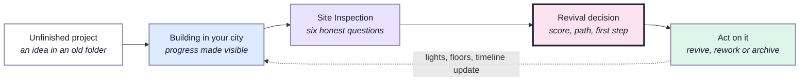

**Who it is for**

| Who | What they get |
|---|---|
| Student builders | A record of their work and a reason to return |
| Hackathon participants | Saved context and co-builders after the team scatters |
| Working developers | The one side project actually worth reviving |
| Designers and makers | A visual, non technical home for unfinished work |

---

## 03 · The city metaphor

> **Height = progress. Darkness = time since last touched.**

| Project information | What you see in the city |
|---|---|
| What the project was | Building name plate and project page |
| What was completed | Solid, lit floors, one per completed part |
| What is still unfinished | Dashed scaffolding floors on top |
| Why it stopped | A sign at the base, for example `PAUSED: TIME` |
| Time since last activity | Windows go dark: most lit under 30 days, half lit up to 180, then dark |
| Being revived | A crane on the roof, lights return, floors animate in |
| Rebuilt | No scaffolding, a small flag on the roof |
| Archived with intent | A stone landmark with a plaque of lessons learned |

---

## 04 · Site Inspection and Revival Score

Six questions, one per screen, with a scanner line moving up the building as a progress bar.

| # | Question | Points |
|:-:|---|---|
| Q1 | How much of the project is done? | 0 to 25 (percent of 25) |
| Q2 | Why did it stop? | event 20, time 18, scope 14, technical 12, motivation 8, weak idea 4 |
| Q3 | Do you still care about this idea? | 1 to 5 maps to 0, 10, 18, 26, 30 |
| Q4 | Is the problem still relevant? | Yes 15, Somewhat 8, No 0 |
| Q5 | How much effort is left? | Under a week 10, A few weeks 5, Months 2 |
| Q6 | Are any parts reusable elsewhere? | Used to pick the path |

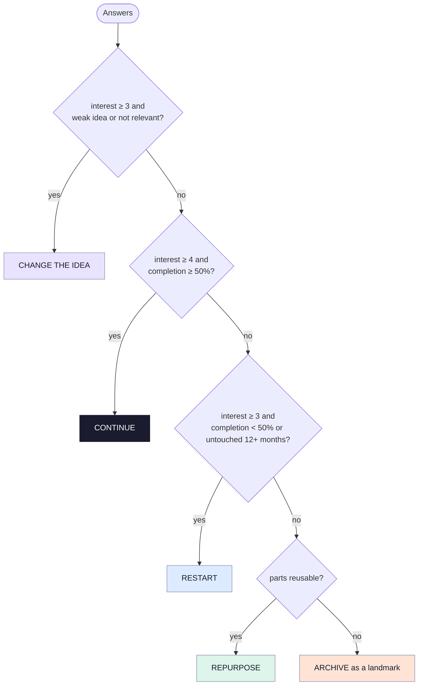

**Worked example: Habit Tracker**

| Interest | Completion | Reason: time | Relevance | Effort | **Score** |
|:-:|:-:|:-:|:-:|:-:|:-:|
| 26 / 30 | 15 / 25 | 18 / 20 | 8 / 15 | 5 / 10 | **72** |

> **Path:** CONTINUE · **Why:** 60 percent done, stopped because of time not because the idea was bad, and you still care about it. · **First step:** spend about 2 hours finishing Reminders.

Every result comes with reasoning and a two hour first step. **The builder always decides.**

---

## 05 · Features

| Feature | What it does |
|---|---|
| **My City** | Every project as an isometric building, with a list view, search and filters as a non visual alternative |
| **Add a project** | A form with a live building preview that grows as you type parts |
| **Project page** | Building with its reason sign, goal, parts, tools, links, status actions |
| **Construction log** | A dated timeline of every change, newest first |
| **Site Inspection** | Six questions, Revival Score ring, recommended path, reasoning, first step |
| **Revival paths** | Continue, Restart, Change the idea, Repurpose a part, Archive with lessons |
| **Revisit prompt** | Suggests the paused project you have not looked at the longest |
| **Activity grid** | GitHub and LeetCode style 26 week grid with streak and totals |
| **Revival Leaderboard** | Ranks builders by projects revived, not started. All time and this month |
| **Builders' Square** | Open a project to co-builders with the skills it needs; others request to join |
| **Multilingual hello** | Hello, Namaste, Hola, Bonjour, Konnichiwa, Hallo, once per session, skippable |
| **Light and dark** | Dark mode turns the city into a night scene with glowing windows |

---

## 06 · User flow

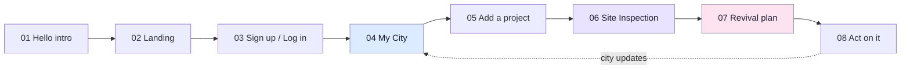

Always one tap away in the menu: **Revival Leaderboard**, **Builders' Square**, **Profile and activity grid**.

---

## 07 · Architecture

Frontend only. No backend, no external APIs. Everything runs in the browser and persists to `localStorage`.

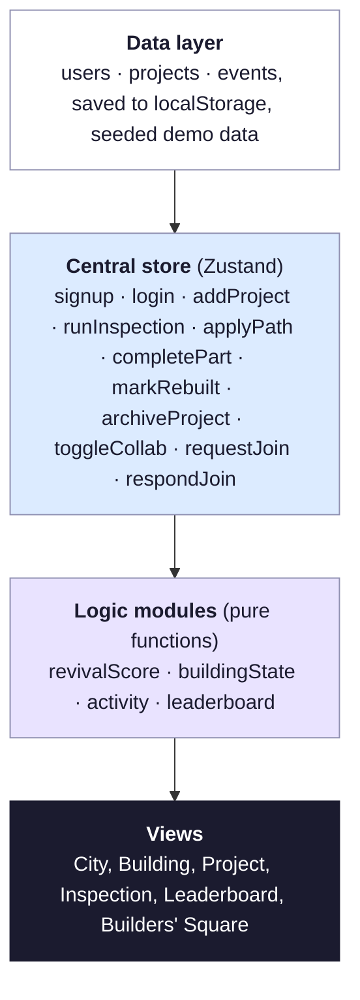

**Built to change fast (Surprise Challenge ready)**

- Questions, options, weights and paths live in **one config object** in `logic/revivalScore.js`.
- Statuses and their visuals live in **one map** in `logic/buildingState.js`.
- Every change goes through a store action that also updates `lastTouchedOn` and logs an activity event, so **a new field is one model change plus one visual layer.**
- Views never keep their own copy of data. One change updates every screen.

| Layer | Choice |
|---|---|
| Framework | React 18 + Vite (JavaScript) |
| Styling | Tailwind CSS v4 with CSS variable design tokens |
| Animation | Motion (Framer Motion), Lenis smooth scroll |
| Routing | React Router v6 |
| State | Zustand with `persist` |
| Buildings | Hand written isometric SVG generated from project data |
| Icons | lucide-react |
| Auth | Client side demo auth, SHA-256 hashed with Web Crypto |
| Deploy | Vercel |

---

## 08 · Design language

- **Type:** system sans at weight 450 with tight tracking for headings and body, **JetBrains Mono** in uppercase for labels and buttons.
- **Colour:** soft baby pastels (sky, lilac, pink, peach, mint) as gradients, warm window light `#FFC56E` as the single accent.
- **Illustration:** an isometric city drawn in plain SVG: buildings, roads, street lamps, trees, a park and little cars. No 3D library.
- **Motion with meaning:** floors rise when parts are added, scaffolding fills in when a part is done, lights switch on at revival. `prefers-reduced-motion` is respected everywhere.
- **Tone:** encouraging, never shaming. Abandoned projects are *paused construction*, never failures.
- **Accessible:** list view beside the city, visible focus rings, full keyboard navigation, WCAG AA text contrast, sideways scrolling skyline on phones.

---

## 09 · Build progress

Live build: **24 October 2026, 12:00 to 23:59 IST.**

| Time | Phase | Status |
|---|---|:-:|
| 12:00 | 1 · Setup: Vite, Tailwind, Router, Zustand, tokens, Navbar, menu, seed data, isometric hero city | ✅ |
| 13:00 | 2 · Buildings and My City, city and list views | ⏳ |
| 15:00 | 3 · Add project with live preview, project page, timeline | |
| 16:00 | 4 · Site Inspection, score, path, first step | |
| 17:00 | 5 · Auth, landing, **first deploy** | |
| 18:00 | 6 · **Surprise Challenge**, activity grid, leaderboard, Builders' Square | |
| 21:00 | 7 · Polish: intro, motion, responsive, accessibility | |
| 23:00 | 8 · Ship | |

---

## 10 · Repository layout

```
HalfBuild/
├── frontend/                  the web app (React + Vite)
│   ├── src/
│   │   ├── store/             Zustand store and seed data
│   │   ├── logic/             pure functions: score, building state, activity, leaderboard
│   │   ├── iso/               isometric SVG city: buildings, lamps, roads, trees
│   │   ├── components/        Navbar, menu, shared UI
│   │   └── pages/             one file per route
│   └── vercel.json            SPA rewrite so routes work on refresh
└── Problem_approach/
    ├── HALFBUILT_Round1_Deck.pdf
    ├── HALFBUILT_Build_Spec.pdf
    └── slides/                deck pages as images
```

---

## 11 · Quick start

```bash
git clone https://github.com/Raginipawar/HalfBuild.git
cd HalfBuild/frontend
npm install
npm run dev        # http://localhost:5173
npm run build      # production build
```

Deploying on Vercel: import the repo and set **Root Directory** to `frontend`.

---

## 12 · Presentation

Round 1 idea submission, Code Variant Build 01, Problem Statement 05.
**[Download the full deck (PDF)](Problem_approach/HALFBUILT_Round1_Deck.pdf)**

<table>
<tr>
<td width="50%">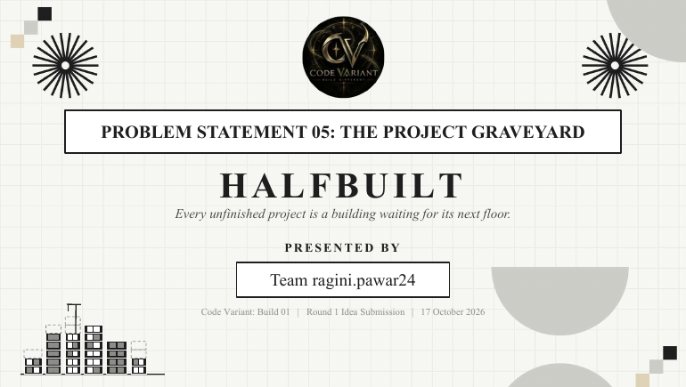</td>
<td width="50%">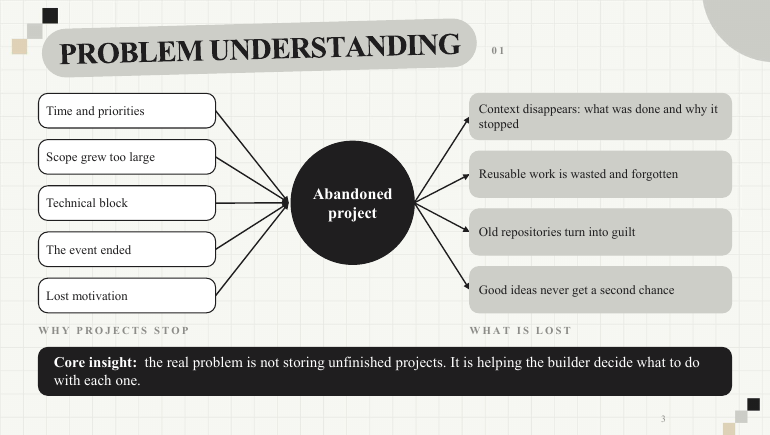</td>
</tr>
<tr>
<td>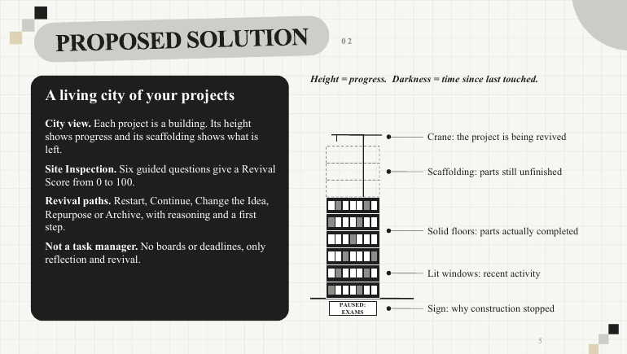</td>
<td>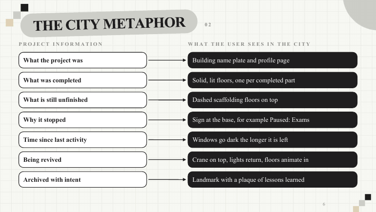</td>
</tr>
<tr>
<td>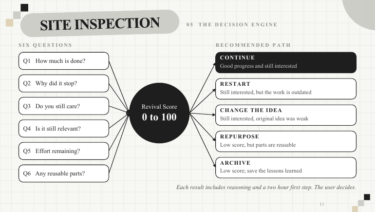</td>
<td>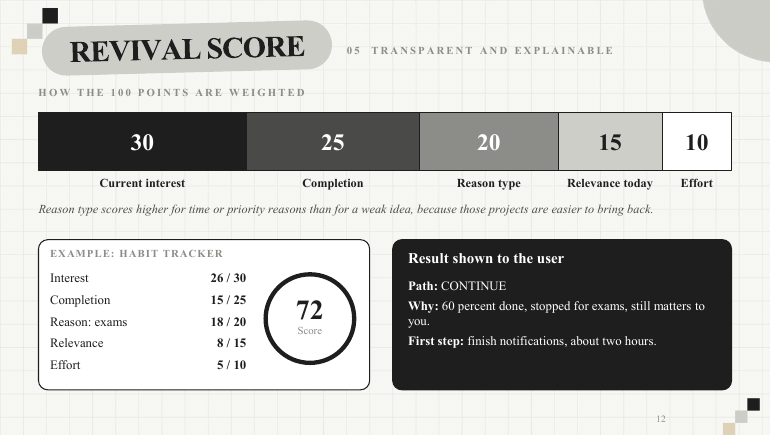</td>
</tr>
<tr>
<td>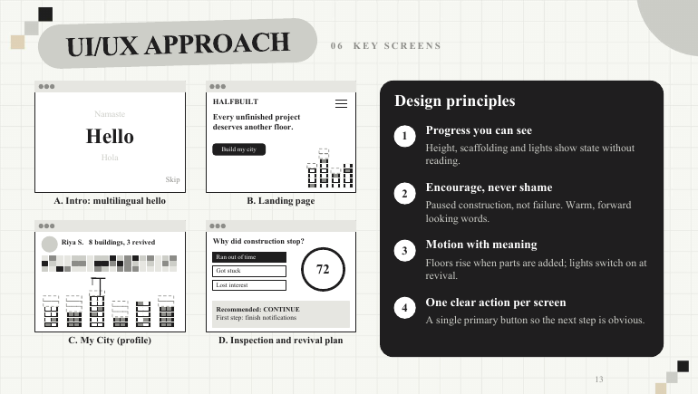</td>
<td>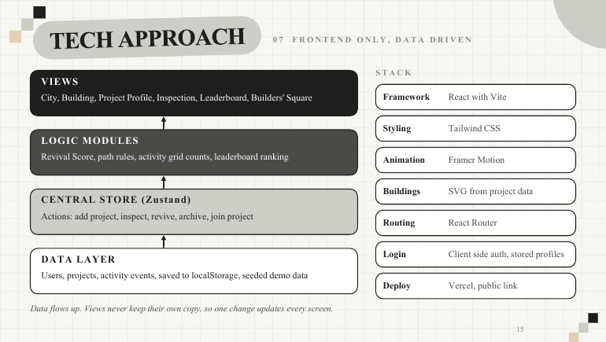</td>
</tr>
</table>

<details>
<summary><b>See all 21 slides</b></summary>
<br/>

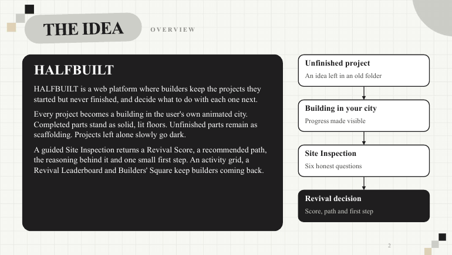 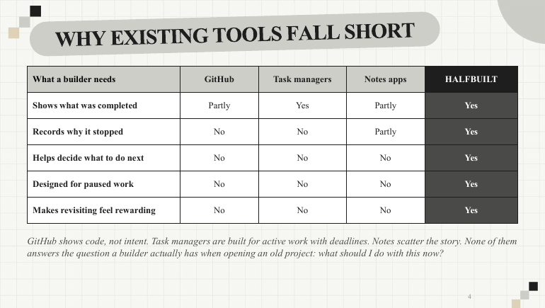
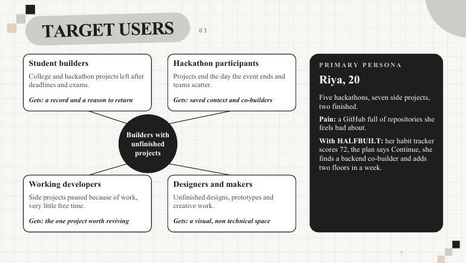 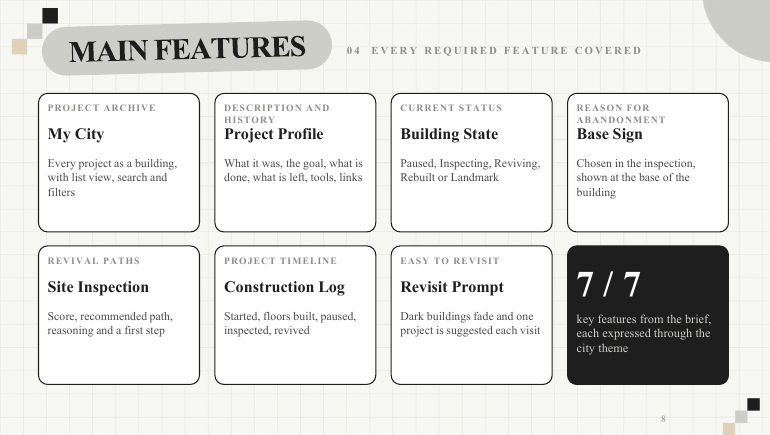
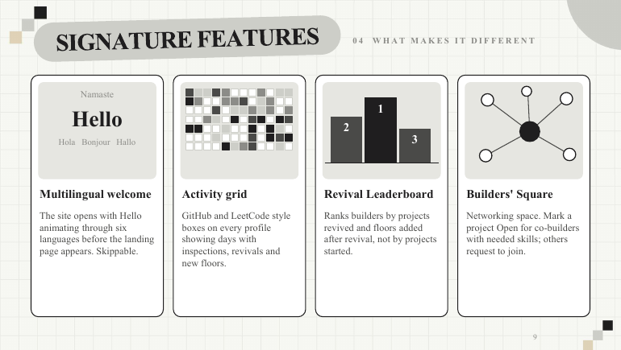 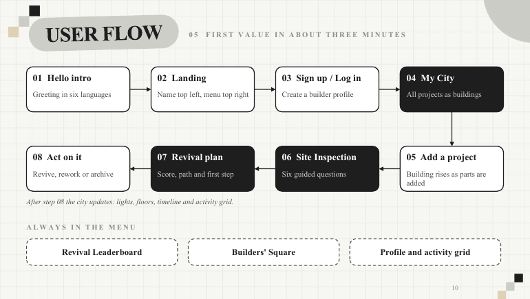
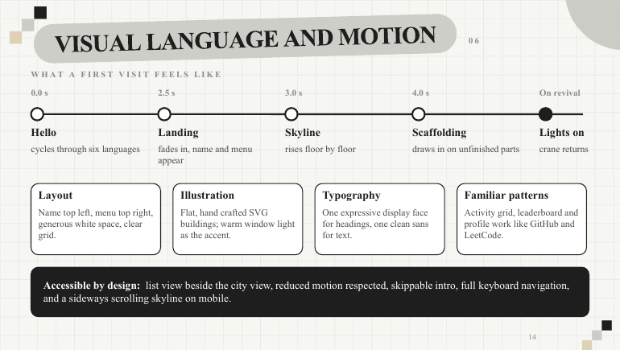 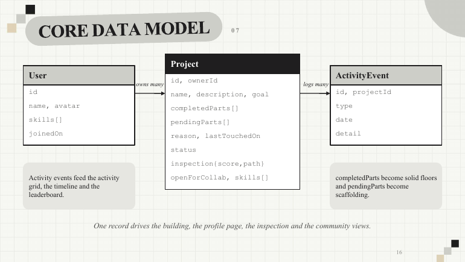
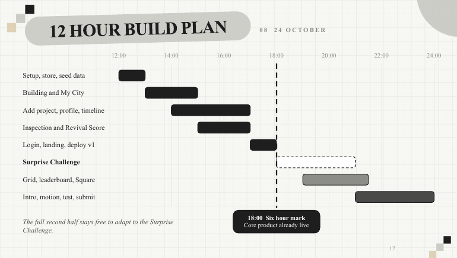 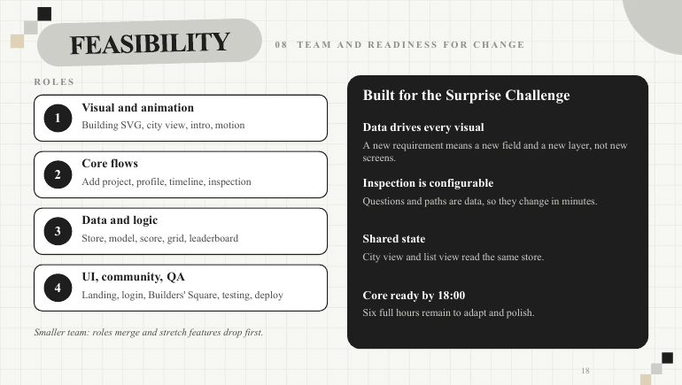
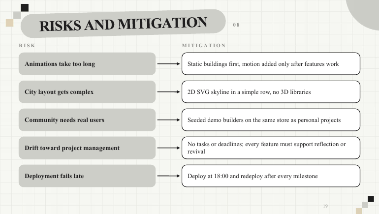 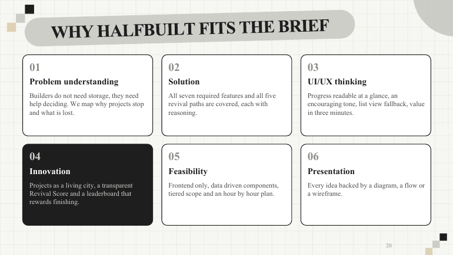
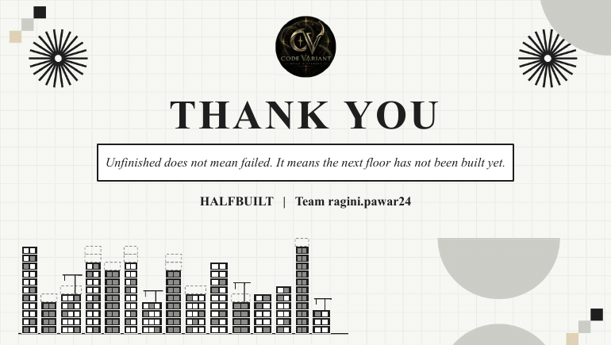

</details>

---

## Team

**Team ragini.pawar24** · Ragini Pawar

GitHub: [github.com/Raginipawar/HalfBuild](https://github.com/Raginipawar/HalfBuild)

<div align="center">

<br/>

> *"Unfinished does not mean failed. It means the next floor has not been built yet."*


</div>
